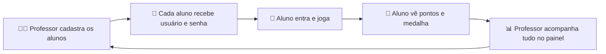

# 🏙️ FINANCITY
### A jornada das decisões financeiras

**Um jogo de Educação Financeira para o 8º ano, onde cada escolha ensina algo novo.**

🎮 &nbsp;**[Abrir o Financity](https://financity-eta.vercel.app)**

---

## 🧭 Por onde você quer começar?

| Eu sou… | Quero saber… | Vá direto para |
|---|---|---|
| 👩‍🏫 **Professor(a)** | como cadastrar alunos e acompanhar a turma | [Guia do professor](#-guia-do-professor) |
| 🎒 **Aluno(a)** | como entrar e jogar | [Guia do aluno](#-guia-do-aluno) |
| 🤔 **Curioso(a)** | o que é o jogo e o que ele ensina | [O que é o Financity](#-o-que-é-o-financity) |
| ⭐ **Qualquer pessoa** | como os pontos funcionam | [Como os pontos funcionam](#-como-os-pontos-funcionam) |
| 🔒 **Responsável ou direção** | como os dados dos alunos são cuidados | [Cuidado com os dados](#-cuidado-com-os-dados) |
| ❓ **Com uma dúvida** | respostas rápidas | [Perguntas frequentes](#-perguntas-frequentes) |

---

## 🌟 O que é o Financity

O Financity transforma situações do dia a dia em **desafios de decisão**. O aluno acompanha o personagem **Alex** por uma cidade cheia de escolhas: uma compra com defeito, uma promoção que parece boa demais, uma mensagem suspeita no celular.

Em vez de decorar regras, o aluno **pensa, escolhe e descobre** o que cada decisão provoca. Quem acompanha o aluno é a **Nina**, uma guia que explica o jogo, comenta as respostas e, no tutorial, até fala com voz própria. 🎙️

### 🗺️ Os 4 temas da jornada

Cada tema tem **8 desafios** e vale **240 pontos**. Eles são liberados em ordem: terminou um, abre o próximo.

| # | Tema | O que o aluno exercita |
|:-:|---|---|
| 1 | 🏛️ **Cidadania Financeira** | Direitos do consumidor, prestação de contas, custo total de uma compra |
| 2 | 🤝 **Ética Financeira** | Transparência, nota fiscal, honestidade no caixa |
| 3 | 🛡️ **Segurança Digital e Privacidade** | Golpes e *phishing*, proteção de dados, privacidade |
| 4 | 🧮 **Consumo Consciente e Matemática** | Publicidade, porcentagem, orçamento |

### 🎯 Três jeitos de responder

- **Escolher uma resposta**: a mais adequada entre quatro.
- **Marcar várias**: o aluno seleciona todas as que se aplicam.
- **Colocar em ordem**: organizar as etapas de uma situação na sequência certa.

Se o aluno travar, pode pedir uma **dica, e ela não tira pontos**. 💡

### 🏅 As medalhas

Ao concluir um tema, o aluno ganha uma medalha de acordo com o aproveitamento:

| Aproveitamento | Medalha |
|:-:|---|
| 92% ou mais | 🥇 **Mestre** |
| 76% ou mais | 🥈 **Guardião das Boas Decisões** |
| 52% ou mais | 🥉 **Aprendiz Financeiro** |
| menos de 52% | 🧭 **Explorador em Desenvolvimento** |

> 💬 Não existe "reprovado". Quem fica como Explorador recebe um convite para conversar com o professor e tentar de novo.

### 🔄 A jornada, do começo ao fim

---

## 👩‍🏫 Guia do professor

Tudo é feito no **Painel do professor**. O menu no alto tem seis áreas:

| Área | Para que serve |
|---|---|
| 📈 **Painel** | Visão geral da turma: quantos jogaram, médias, gráficos e uma leitura automática dos resultados |
| 👥 **Alunos** | Cadastrar alunos, gerar senhas, redefinir, desativar ou excluir |
| 🟢 **Presença** | Ver quem está **on-line agora**, a hora que entrou, a hora que saiu e quanto tempo ficou |
| ❓ **Questões** | Ver cada desafio (de 1 a 8): quantos acertaram, o que escolheram e quem escolheu |
| 📄 **Relatórios** | Relatório da turma pronto para **imprimir ou salvar em PDF**, e planilhas por aluno e por questão |
| ⚙️ **Configurações** | Nome da escola, nome do professor (aparecem nos relatórios) e troca de senha |

No canto do menu há também o botão **🌙 Modo escuro**, que descansa os olhos em salas mais escuras. A sua escolha fica guardada.

<b>🚀 Primeiros passos (clique para abrir)</b>

1. **Entre** com o usuário e a senha de professor.
2. Abra **Configurações** e preencha o **nome da escola**. Ele sai no cabeçalho dos relatórios.
3. Vá em **Alunos** e cadastre a turma de um destes três jeitos:
   - **um aluno por vez**, preenchendo nome e turma;
   - **uma lista**, escrevendo uma linha por aluno no formato `Nome;Turma`;
   - **uma planilha**, escolhendo um arquivo CSV.
4. Clique em **GERAR SENHAS AUTOMATICAMENTE**. Cada aluno recebe um **usuário** e uma **senha de 6 números**.
5. **Imprima as fichas** e entregue uma a cada aluno.

> ⚠️ **A senha de 6 números aparece só uma vez**, na hora em que é criada. Imprima ou anote antes de fechar a tela. Se alguém esquecer, é só **redefinir** (veja abaixo).

<b>🟢 Acompanhando a turma em tempo real</b>

Na aba **Presença** você vê, para cada aluno:

- **● On-line / ○ Off-line**: se ele está com o jogo aberto agora;
- **Última entrada** e **última saída**;
- **Tempo hoje** e **tempo total** na plataforma;
- **Histórico**: cada vez que o aluno entrou, a que horas, por quanto tempo e como saiu.

A tela se atualiza sozinha a cada 15 segundos.

**Como o "on-line" funciona:** o jogo dá um sinal de vida a cada 30 segundos. Quem deu sinal nos últimos 2 minutos aparece como on-line. Se o aluno **fechar a página sem clicar em Sair**, a hora de saída é a do último sinal, com diferença de até meio minuto.

<b>🛠️ Cuidando dos alunos no dia a dia</b>

| Preciso… | Como fazer |
|---|---|
| **Dar uma senha nova** a quem esqueceu | **Alunos** → **Redefinir PIN** |
| **Impedir o acesso por um tempo** | **Alunos** → **Desativar** (dá para reativar depois; nada se perde) |
| **Apagar um aluno de vez** | **Alunos** → **Excluir**. O sistema pede que você digite `EXCLUIR` para confirmar. ⚠️ **Não dá para desfazer**: some o cadastro, as respostas e o histórico |
| **Deixar um aluno jogar o tema de novo** | Abra o aluno e libere uma **nova tentativa**. A anterior fica guardada no histórico |
| **Testar os gráficos sem usar alunos reais** | **Painel** → **Gerar dados de demonstração**. São dados fictícios e ficam separados dos reais |

<b>📊 Entendendo os relatórios</b>

- **Painel**: gráficos de desempenho por tema, distribuição de pontuações, média por questão e progresso da turma.
- **Questões**: clique em Q1 a Q8 para ver quantos alunos escolheram cada alternativa e **quem** escolheu. É ótimo para descobrir **o que retomar em sala**.
- **Relatórios**: botão **Exportar PDF** (na janela de impressão, escolha "Salvar como PDF") e planilhas com os resultados por aluno e por questão.
- Os filtros de **série**, **turma** e **tema** ficam no alto de cada tela.
- Por padrão aparecem só **dados reais**. Dados de demonstração só entram se você escolher.

---

## 🎒 Guia do aluno

<b>🎮 Como entrar e jogar</b>

1. Abra o endereço do jogo: **https://financity-eta.vercel.app**
2. Digite o **usuário** e a **senha de 6 números** que o professor entregou.
3. Escolha o tema que está liberado e clique para começar. A **Nina** vai explicar como tudo funciona.
4. Leia a situação com calma, **escolha a atitude que você considera mais adequada** e confirme.
5. Ao terminar os 8 desafios, veja seus pontos e a sua medalha. 🏅

<b>💡 Dicas para jogar melhor</b>

- **Não precisa correr.** O tempo que você leva não vale pontos.
- Use a **dica** se precisar. Ela **não tira pontos**.
- Não dá para voltar a uma pergunta já respondida, então confirme só quando tiver certeza.
- As alternativas **mudam de lugar** a cada tentativa. Não adianta decorar a letra.
- Ao terminar, **clique em Sair** para fechar o jogo com segurança.

---

## ⭐ Como os pontos funcionam

**Todo desafio vale 30 pontos** e cada tema vale **8 × 30 = 240 pontos**.

<b>🎯 Quanto vale cada resposta</b>

**Nos desafios de escolher uma resposta**, cada alternativa vale uma destas notas:

| Alternativa | Pontos |
|---|:-:|
| ✅ A resposta mais adequada | **30** |
| 🟡 Quase certa | **20** |
| 🟠 Tem uma parte certa | **10** |
| ❌ Inadequada | **0** |

**Nos desafios de marcar várias:** quanto mais certas, mais pontos, e marcar alternativas erradas desconta. Marcar **todas** não dá nenhum ponto.

**Nos desafios de colocar em ordem:**

| Resultado | Pontos |
|---|:-:|
| Ordem toda certa | **30** (100%) |
| Duas ligações certas | cerca de **20** (65%) |
| Uma ligação certa | cerca de **9** (30%) |
| Nenhuma | **0** |

<b>🕰️ Os pontos mudaram. E as notas antigas?</b>

Os valores foram **padronizados**: antes, alguns desafios valiam 20 e outros 40. Agora todos valem 30, e o total de cada tema continua **240**.

- Quem **já tinha jogado** (ou estava no meio de um tema) **mantém os pontos de antes**. Nada foi recalculado nem perdido.
- Quem começar um tema **a partir de agora** joga com os valores novos.
- Os relatórios já levam isso em conta, para as comparações continuarem justas.

---

## 🔒 Cuidado com os dados

Os alunos são menores de idade, então a proteção dos dados é levada a sério.

- 🙈 **Cada professor vê só os alunos das próprias turmas.**
- 🔑 As senhas são guardadas de forma protegida: nem o sistema consegue "ler" a senha de um aluno depois de criada.
- 🧾 Os **pontos e as respostas certas ficam guardados no servidor**. O aluno nunca recebe o gabarito no celular ou no computador.
- 🧹 **Excluir um aluno apaga tudo** sobre ele, de forma definitiva: cadastro, respostas, histórico e presença.
- ⏱️ Para a presença, o sistema guarda **apenas horários** (entrou, saiu, quanto tempo ficou). Nada além disso.
- 💾 São feitas **cópias de segurança todos os dias**.
- 🚫 O jogo **não pede dados pessoais** do aluno além do nome e da turma.

---

## ❓ Perguntas frequentes

<b>O aluno esqueceu a senha. E agora?</b>

No painel, abra **Alunos** e use **Redefinir PIN** ao lado do nome dele. Uma senha nova de 6 números é criada, e você pode imprimir de novo a ficha.

<b>O aluno digita certo e não consegue entrar.</b>

Confira, nesta ordem:
1. Se o **usuário** está idêntico ao da ficha (sem espaços sobrando).
2. Se a senha tem **exatamente 6 números**.
3. Se o aluno **não está desativado** (aparece na lista de Alunos).
4. Depois de **várias tentativas erradas**, o sistema espera alguns minutos antes de deixar tentar de novo. Isso protege contra tentativas de invasão.

<b>Um aluno aparece como "off-line" mesmo estando no jogo.</b>

O status se atualiza com o sinal de vida que o jogo envia a cada 30 segundos. Se o aluno estava com a página aberta **antes** de uma atualização do sistema, peça para ele **recarregar a página**. Depois disso, em até 30 segundos ele aparece como on-line.

<b>O aluno fechou a página sem clicar em Sair. Perdeu o que fez?</b>

Não. As respostas ficam salvas a cada desafio. Ele entra de novo e **continua de onde parou**. Só a hora de saída na Presença é aproximada.

<b>Para que servem os "dados de demonstração"?</b>

Para você **conhecer os gráficos e relatórios** sem precisar de alunos de verdade. São alunos fictícios, claramente identificados como **DEMO**, que ficam separados dos dados reais. Você pode remover tudo com um clique.

<b>Quando chega o 7º ano?</b>

O sistema já está preparado para turmas do 7º ano: cada aluno vê apenas os temas da sua série. Enquanto os temas do 7º ano não são publicados, os alunos dessa série veem a mensagem **"Seus temas chegam em breve!"**.

<b>Posso usar o painel no celular?</b>

Pode. As telas se ajustam ao tamanho do aparelho. Para relatórios e fichas impressas, o computador costuma ser mais confortável.

---

## 📚 Quer saber mais?

<b>Documentos para quem cuida do sistema</b>

Estes arquivos têm linguagem mais técnica e são voltados a quem faz a manutenção do Financity:

- [Histórico do projeto](docs/HISTORICO.md): tudo o que já foi feito e as decisões tomadas.
- [Como publicar e reverter uma atualização](docs/PUBLICACAO-E-REVERSAO.md)
- [Conteúdo do 7º ano](docs/CONTEUDO-7-ANO.md): como preparar os temas do 7º ano.
- [Leia-me técnico (primeira versão)](docs/LEIA-ME-TECNICO.md)

---

**🏙️ Financity** · Educação Financeira com decisões de verdade

*Feito com carinho para a sala de aula.* 💜

